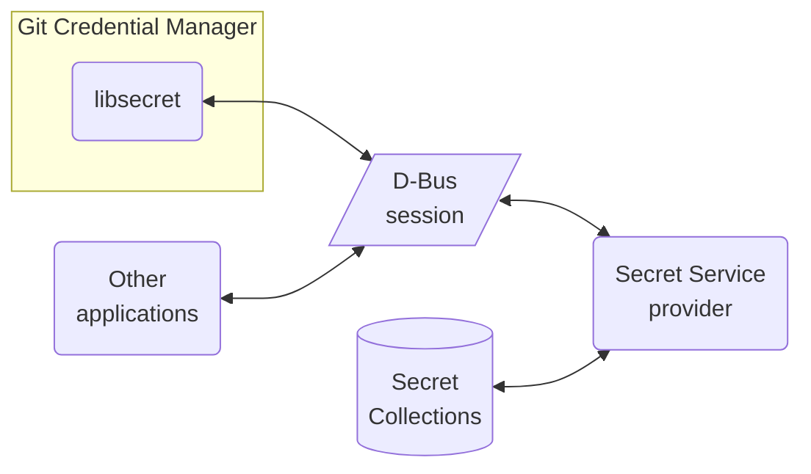

# Secret Service in headless Linux sessions

Git Credential Manager (GCM) can use Secret Service without a graphical
desktop, provided a provider is available and the required keyrings are
unlocked.

## How Secret Service fits together

Secret Service is a standard API for storing and retrieving secrets.
A **provider** implements that API, stores the secrets, and controls access
to them. Example providers include [GNOME Keyring][gnome-keyring],
[KWallet][kwallet], and [oo7][oo7].

[D-Bus][dbus] carries messages between applications and the provider; it
does not store the secrets itself. GCM's `secretservice` credential store
uses the `libsecret` library to communicate with the provider over the user's
D-Bus session bus.



For GCM to use this store, it needs:

- Access to a user/session bus.
- A Secret Service provider running, or able to start on demand, on that bus.
- A default collection for storing credentials, with the required collections
  unlocked. GNOME Keyring and oo7 call these **keyrings**; KWallet calls them
  **wallets**.

> [!NOTE]
> On systems with [systemd][systemd], the user D-Bus session bus and installed
> Secret Service providers are typically started automatically. Providers may be
> started on demand through D-Bus activation when an application requests them.

## Unlocking without a desktop

Secret Service allows applications to request that a collection be unlocked,
but the provider controls authentication and prompting. On a desktop, this
often means a graphical password prompt. The standard API does not let GCM
supply the collection's password or choose a terminal prompt such as pinentry.

In a headless session, the collection must already be unlocked, or the
provider must offer a way to unlock it without a graphical prompt. Available
options depend on the provider and may include command-line tools or login
integration, such as PAM. Installing a terminal pinentry program alone does
not make a provider's graphical prompts work headlessly.

**Starting the bus or provider is not the same as unlocking a collection.**
An unlocked collection needs no further input. After a reboot or provider
restart, it must be unlocked again, either through configured automatic
unlocking or user interaction. Unattended workloads need a setup that does
not depend on an interactive password prompt.

## Setup Guides

### Ubuntu Server + GNOME Keyring

These instructions use Ubuntu Server 24.04 to create a password-protected
keyring and reuse it on future logins. Ubuntu's packages provide automatic service
startup; no custom systemd configuration is needed.

Run these steps as the user who runs Git. Use `sudo` only where shown.

#### 1. Set up the keyring

##### Install the dependencies

```shell
sudo apt-get update
sudo apt-get install --no-install-recommends \
  dbus dbus-user-session gnome-keyring libsecret-tools
```

##### Check the D-Bus session

```shell
busctl --user list
```

On a standard Ubuntu Server login, the user bus is already available.
If the command lists services, continue in the same shell.

If no user bus is available, start a temporary session:

```shell
dbus-run-session -- bash
```

Run the remaining keyring setup commands inside this new shell.

##### Create an unlock command

Create this small helper so you do not have to repeat the password-handling
commands each time. The helper **does not store your password**.

```shell
mkdir -p "$HOME/.local/bin"
cat > "$HOME/.local/bin/unlock-keyring" <<'EOF'
#!/usr/bin/env bash
set -euo pipefail
set +x

if ! IFS= read -r -s -p 'Keyring password: ' password </dev/tty; then
  printf '\nCould not read the keyring password.\n' >&2
  exit 1
fi
printf '\n' >/dev/tty
if [[ -z "$password" ]]; then
  printf 'Use a non-empty keyring password.\n' >&2
  exit 1
fi

printf '%s' "$password" |
  gnome-keyring-daemon --daemonize --replace --unlock --components=secrets
EOF
chmod 700 "$HOME/.local/bin/unlock-keyring"
```

Start the daemon and create or unlock the login keyring:

```shell
~/.local/bin/unlock-keyring
```

On first use, choose a non-empty keyring password. On later uses, enter
that same password. This is the **keyring password**, not a Git access token.
The encrypted keyring is saved in your home directory.

The command replaces any GNOME Keyring daemon it discovers, so it may
interrupt other applications using that daemon.

##### Select the credential store

```shell
git config --global credential.credentialStore secretservice
```

GCM can now use the keyring. To check that it is unlocked:

```shell
busctl --user get-property org.freedesktop.secrets \
  /org/freedesktop/secrets/collection/login \
  org.freedesktop.Secret.Collection Locked
```

The expected output is `b false`.

#### 2. Use the keyring on future logins

On a standard Ubuntu Server login, the user bus starts automatically.
Installing GNOME Keyring also installs its D-Bus activation configuration:
the bus can start the provider when an application requests it.

You can see this with:

```shell
busctl --user list | grep org.freedesktop.secrets
```

An `(activatable)` entry means the provider can start on demand. A PID means
it is already running. You do not need to enable additional systemd units
or change `.bashrc` for this setup.

After a reboot, or whenever the keyring is locked, unlock it before using GCM:

```shell
~/.local/bin/unlock-keyring
```

Use the password you chose in part 1, then use Git normally. If the collection
is already unlocked, no unlock command is needed.

If you used a temporary `dbus-run-session` shell, its bus ends when you leave
that shell. Start another session as described in part 1 when needed.

## Troubleshooting

Read the complete error, including any native error printed after GCM's
message. For example, `Failed to open the Secret Service session` can mean
a collection could not be loaded, not just that the provider is missing.

Symptom|What to check
-|-
`No credential store has been selected`|Select the store with `git config --global credential.credentialStore secretservice`.
`Failed to connect to the D-Bus session bus` or `Cannot autolaunch D-Bus without X11 $DISPLAY`|Run `busctl --user list` as the user who runs Git, without `sudo`. If no user bus is available, follow the [D-Bus session setup](#check-the-d-bus-session).
`ServiceUnknown` or `NameHasNoOwner`|A required D-Bus service is unavailable. Check whether `org.freedesktop.secrets` is running or activatable in `busctl --user list`. If it is, the error may refer to another component, such as the provider's prompter; check the service named in the error.
`No such secret collection at path: ...` or `Object does not exist` for a collection path|The collection may be missing or the provider's state may be inconsistent. Check the default collection as described below.
`Cannot get secret of a locked object`, `Failed to unlock the secret item`, or a prompt that cannot open a display|Unlock the collection using the provider's headless unlocking method, then retry. Starting the provider or installing pinentry alone does not unlock it.
`secret-tool lookup` returns no output and exits with `1`|No accessible matching secret was returned. This can mean either no matching entry or an unsuccessful unlock. Unlock the collection and retry with a known existing entry.
`libsecret-1.so.0` cannot be loaded|Check that the libsecret runtime is installed for the architecture GCM is running on. On Ubuntu, the package is `libsecret-1-0`.

### Check the default collection

The default collection is an alias, not necessarily a collection named
`login`. Ask the provider where it points:

```shell
busctl --user call org.freedesktop.secrets \
  /org/freedesktop/secrets org.freedesktop.Secret.Service \
  ReadAlias s default
```

An output of `o "/"` means no default collection is assigned. Use the
provider's tools to create or select one. Otherwise, inspect the returned
collection path rather than assuming it is the GNOME `login` keyring.

If the provider advertises a collection but cannot return its properties,
restarting it may resolve inconsistent state. With GNOME Keyring, this can
occur when independently started daemons create or unlock the keyring while
another daemon serves D-Bus. The [unlock helper](#create-an-unlock-command)
replaces the daemon it discovers, but may interrupt other applications.
Do not delete keyring files to resolve a missing-object error.

[dbus]: https://www.freedesktop.org/wiki/Software/dbus/
[gnome-keyring]: https://wiki.gnome.org/Projects/GnomeKeyring
[kwallet]: https://invent.kde.org/frameworks/kwallet
[oo7]: https://github.com/linux-credentials/oo7
[systemd]: https://systemd.io/
